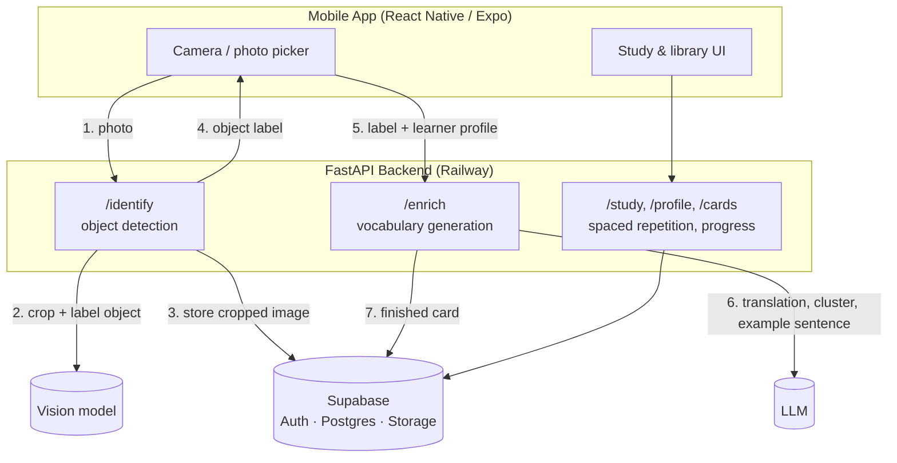

# Kisogo

Point your camera at anything and get a vocabulary flashcard for it, in your target language, pitched at your level.

**Status:** Live on [Google Play](https://play.google.com/store/apps/details?id=com.kisogo.app&pli=1) · iOS submission pending.

---

## Features

- **Photo → vocabulary card.** Point the camera at an object; the app identifies it and generates a full flashcard (translation, a small cluster of related words, an example sentence) in the target language.
- **30+ target languages**, including non-Latin scripts (Japanese, Chinese, Korean, Arabic, Hebrew, etc.) with automatic romanization for readability.
- **Proficiency-aware generation.** Beginner, intermediate, and advanced modes change vocabulary difficulty and sentence complexity — not just the translation.
- **Spaced repetition.** Reviewed cards are rescheduled automatically so learners spend time on what they're about to forget.
- **Daily goals & streaks.** A configurable daily review goal with streak tracking to encourage a consistent habit.

---

## Architecture

The system is a thin mobile client talking to a stateless backend that fans a single photo out into two separate AI calls, backed by a managed data platform.



- **Mobile app** — React Native (Expo), handles camera capture, auth, and the study/review UI.
- **FastAPI backend** — a stateless service deployed on Railway; every request is authenticated against a Supabase-issued JWT.
- **Vision model** — identifies the primary object in the photo and returns a bounding box used to crop a clean card image.
- **LLM** — generates the language content: translation, a small cluster of related vocabulary, and an example sentence, tuned to the learner's proficiency level.
- **Supabase** — authentication, Postgres (user profiles, cards, review history), and object storage for card images.

---

## The two-stage AI pipeline

Identification and content generation are deliberately split into two independent API calls instead of one combined call:

1. **Identify** — `gpt-5.6-luna` (OpenAI's vision-capable model) looks at the photo and returns *just* the object's name and a bounding box. This is the fast, cheap step. It also lets the backend crop and store a consistent-looking card image before anything else happens.
2. **Enrich** — `gpt-4o-mini` takes the identified label plus the learner's target language, native language, and proficiency level, and generates the actual flashcard content: translation, related-word cluster, and an example sentence (with romanization for non-Latin scripts).

Enrichment is deliberately handed to the smaller, cheaper `gpt-4o-mini` rather than the vision model: by the time this step runs, the hard part (recognizing the object) is already done, so the remaining work is comparatively simple text generation. A lighter model is noticeably cheaper and faster for this, and it's the step that runs most often — whenever a learner changes target language or proficiency level, enrichment can be re-run for the same identified object without paying for another vision call.

Pseudocode for the split:

```
identify(photo) -> { label, bbox }
enrich(label, target_language, proficiency) -> { translation, related_words, example_sentence }
```

Splitting these matters for a few reasons:

- **Cost control before commitment.** Usage limits (free trial vs. paid tiers) are enforced *before* any AI call runs, and the cheaper identify step can fail fast without ever invoking the more expensive generation step.
- **Decoupled retries.** If a learner changes their proficiency level or target language, the app can re-run enrichment on an already-identified object without repeating the vision call.
- **Separation of concerns.** Object recognition and language generation are different problems with different failure modes; keeping them as separate calls makes each easier to reason about, test, and swap out independently.

A legacy combined endpoint still exists for backward compatibility, but the two-stage flow is what the current app uses.

---

## Spaced repetition and learner-progress design

Reviews are scheduled with an **SM-2-based algorithm, adjusted from the textbook version** to fit how the app is actually used. At a high level: each card tracks how well the learner has been recalling it, and every review nudges the next review date further out when recall is good and pulls it back in when it isn't — so time gets spent on what's about to be forgotten rather than what's already known. The exact scheduling parameters are tuned and intentionally not detailed here.

On top of the scheduling algorithm:

- **Daily goal.** Each learner sets how many reviews they want to do per day; once that's hit, the study queue reports "goal reached" rather than continuing to surface due cards.
- **Streaks.** Computed by walking backward day-by-day through review history to find the longest unbroken run of days with at least one review — not stored as a separate counter, so it can't drift out of sync with actual activity.
- **Due queue.** Cards due today or earlier are pulled from storage and capped by the daily goal, so the UI only ever shows a bounded, achievable session.

---

## Key design decisions and trade-offs

- **Two AI calls instead of one** (see above) — more latency-sensitive but cheaper and more flexible than a single combined prompt.
- **SM-2-based scheduling over a learned/ML-based scheduler** — simple, well-understood, and has no cold-start problem; the trade-off is it's less personalized than a model that learns per-user forgetting curves.
- **Supabase as the single data platform** — auth, Postgres, and object storage in one place significantly reduces backend surface area for a small team, at the cost of some vendor lock-in.
- **Stateless backend on Railway** — no server-side session state; every request re-authenticates via JWT, which keeps horizontal scaling and deploys simple.
- **Forced aspect-ratio cropping with padding instead of stretching** — keeps the card UI visually consistent across arbitrary photos without distorting the subject.
- **RevenueCat for billing** — abstracts over the App Store and Play Store purchase APIs so subscription logic isn't duplicated per platform.

---

## Tech stack

**Mobile**
- React Native (Expo SDK 54), TypeScript
- Expo Camera / Image Picker / Image Manipulator
- Supabase JS client (auth session management)
- Sign in with Apple, Google Sign-In
- RevenueCat (`react-native-purchases`) for subscriptions

**Backend**
- FastAPI (Python)
- Pillow for image cropping/normalization
- Vision + language model APIs for the two-stage pipeline
- Supabase Python client (Postgres, Storage, Auth verification)
- Deployed on Railway

**Data & Infra**
- Supabase: Postgres, Auth, Storage
- Railway: backend hosting
- EAS / app store pipelines: mobile builds and releases
